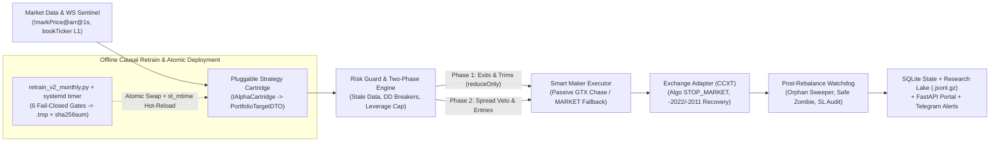

# QuantCore Execution Server

Asynchronous portfolio execution engine and risk management server for **Binance USD-M Perpetual Futures** built with Python (`asyncio`, FastAPI, SQLite, CCXT).
The execution runtime is strictly decoupled from signal generation through the pluggable `IAlphaCartridge` contract (`app/domain/interfaces.py`) and `CartridgeLoaderService` (`app/cartridges/cartridge_loader.py`).
Built-in deterministic risk guardrails, Smart Maker execution, post-rebalance reconciliation, and append-only compressed telemetry keep 24/7 production operation reliable within tight VPS memory budgets (`MemoryMax=550M`).

> **Repository Boundary:** Proprietary strategy cartridges, trained model bundles (`*.joblib`), helper operational scripts (`scripts/`), runtime databases, and credentials are intentionally `.gitignore`-excluded and never stored in public Git.

---

## System Architecture



---

## Core Engineering Highlights

### 1. Two-Phase Rebalance & Smart Maker (`app/services/smart_maker_executor.py`, `execution_service.py`)
- **Two-Phase Dispatched Execution:** Rebalances execute concurrently under `asyncio.Semaphore(SMART_MAKER_CONCURRENCY)` across two sequential barriers:
  - **Phase 1 (`reduceOnly=True`):** Full exits, position trims, and first legs of direction flips run first to release margin before any new exposure opens.
  - **Phase 2 (Entries & Adds):** Filtered by a pre-trade BBO spread veto (`MAX_ALLOWED_SPREAD_PCT`) with symmetric opposite-side notional scaling so spread vetoes do not skew portfolio neutrality.
- **L1 Passive GTX Chase:** Places `LIMIT GTX` orders off lightweight `bookTicker` / WS L1 quotes (avoiding heavy depth snapshots). Orders only reprice when the L1 quote shifts by at least `max(tick_size, arrival_mid * reprice_bps / 10_000)` and abort immediately to `MARKET` if drift exceeds `max_drift_bps`.
- **Exchange Race & Rejection Handling:** Handles both Binance Post-Only rejection modes (`-5022` API errors and zero-fill `EXPIRED` order status), resolves `-2011` (`OrderNotFound`) cancel-vs-fill races via `fetch_order` + `recorded_oids` partial-fill deduplication, applies asymmetric `minNotional` enforcement for `reduceOnly=True` exits, isolates live chase symbols via `active_chase_symbols`, and guarantees limit cancellation + `STOP_MARKET` restoration inside cancellation-safe `finally` blocks (including `asyncio.CancelledError`).

### 2. Exchange Resilience & Reconciliation Watchdog (`exchange_ccxt_service.py`, `execution_service.py`)
- **Idempotent Orders & Conditional Algo SL:** Builds deterministic `newClientOrderId` tokens (`<= 36` chars) verified via `fapiPrivateGetOrder` on network timeouts. Stop losses are submitted as `STOP_MARKET` orders with `workingType="MARK_PRICE"` and `closePosition=True` (with a `reduceOnly=True` quantity fallback), explicitly flagging `-2021` immediate-trigger conditions and reading open conditional triggers in bulk via `fapiPrivateGetOpenAlgoOrders()`.
- **Structured `-2022` Recovery:** Instead of discarding `ReduceOnly Order is rejected` (`-2022`) errors blindly, recovery queries live exchange positions via REST, confirms closure if flat, aborts on side mismatch, cancels blocking open orders, retries `postOnly` / `MARKET reduceOnly`, and re-arms `STOP_MARKET` on any remaining trim balance.
- **Post-Rebalance Reconciliation Watchdog:** After each cycle (while skipping symbols actively locked in Smart Maker chases):
  - **Orphan Sweeper:** Cancels leftover open/conditional orders on flat symbols while sparing pending Phase 2 entries.
  - **Safe Zombie Position Check:** Tracks unrequested positions (`target_weight == 0`) strictly on healthy, non-`fail_closed`, non-empty portfolios — sending a Telegram warning on cycle 1 and forcing one controlled `MARKET reduceOnly` close on cycle 2.
  - **Naked & Duplicate SL Check:** Verifies every open position holds exactly one active `STOP_MARKET`, deduplicating extras and immediately re-arming missing stops from `active_sl_price`.

### 3. Independent Risk Guard & WS Sentinel (`risk_guard_service.py`, `ws_sentinel_service.py`)
- **Hard Risk Guardrails:** Enforces a fail-closed stale candle gate (`BTCUSDT` age and `> 30%` universe staleness), `5%` daily drawdown pause breaker (6h cooldown), `20%` peak-to-trough emergency flatten switch, and `2.25x` gross leverage compression.
- **Sub-Second WebSocket Sentinel (`< 3 MB` RAM):** Consumes `wss://fstream.binance.com/ws/!markPrice@arr@1s` in-memory to execute Breakeven (`+1.20 ATR`), Chandelier Ratchet (`+2.0 ATR`), flash-crash / cascade core wakeups (`> 2.2 ATR`), and passive limit protection.

### 4. Accounting Integrity & Research Data Lake (`database_service.py`, `research_lake_service.py`)
- **Equity Bridge Audit:** Compares live exchange equity against cumulative realized/funding/fee accounting (`ACCOUNTING_DRIFT_TOL_USD=0.05`), raising Telegram alerts whenever divergence exceeds `ACCOUNTING_DRIFT_ALERT_USD` (`$0.50`).
- **Compressed Telemetry Streams:** `ResearchLakeService` writes thread-safe daily `.jsonl.gz` tables (`bar_features`, `order_lifecycle`, `sentinel_events`, `stop_tp_events`) under `data/v3_research_lake/` outside LRU storage eviction, bounded by `MAX_RESEARCH_LAKE_MB` (`1024` MB default).

### 5. Gateway Hardening, Operations & Offline Retrain (`security.py`, `deploy/`, `scripts/`)
- **RBAC & Reverse-Proxy Security:** Separates `admin` and read-only `viewer` roles, supports `.admin_key` file secrets, enforces login rate limiting (`5` attempts / `60s`) with `HttpOnly` cookies, keeps `/docs` (`ENABLE_API_DOCS="false"`) and `?key=` (`ALLOW_QUERY_KEY_AUTH="false"`) disabled by default, and pairs with `deploy/Caddyfile.example` (`403` probe rules, HSTS, `X-Frame-Options: DENY`).
- **VPS Resource Containment:** `deploy_native.sh` provisions a systemd service pinned to `MemoryHigh=450M` / `MemoryMax=550M`, `MALLOC_ARENA_MAX=2`, pre-warmed Numba cache, and an `OnFailure` Telegram dead-man switch (`deploy/notify_systemd_failure.sh`).
- **Offline Causal Retrain Pipeline (Local-Only Tools):** Monthly scheduled retraining (`deploy/quant_v2_retrain.service` + `.timer` -> `scripts/retrain_v2_monthly.py --cpu-only`) validates 6 fail-closed quality gates (`>= 85%` coverage, `>= 192h` causal horizon+purge margin, Purged 90d Tail OOS Spearman IC `> min_ic`, finite prediction coverage `>= 20` on `168h` and `>= 8` on `24h` with `0` NaN/Inf on liquid symbols, cross-sectional std `> 0.1`, monotonic `trained_up_to_ts`) before atomic `.tmp` + `sha256sum` swap and `st_mtime` hot-reload. Additional local operational scripts (`audit_report.py`, `verify_v61_live_parity.py`, `pull_server_analytics.py`, `migrate_v61_epoch_clean.py`) reside in `scripts/` (excluded from public Git).

---

## Repository Layout

```text
QuantCore-GrandMaster-Server/
├── app/
│   ├── api/                 # RBAC-protected control, cartridge, and telemetry endpoints
│   ├── cartridges/          # Strategy loader (cartridge_loader.py) — proprietary cartridges are gitignored
│   ├── core/                # Pydantic settings (.env), auth/RBAC, async event bus, memory & math utils
│   ├── domain/              # Interfaces (IAlphaCartridge, IExchangeGateway), schemas, enums
│   ├── services/            # Execution, CCXT gateway, Smart Maker, WS Sentinel, Risk Guard, State, DB, Telegram
│   └── web/                 # Embedded monitoring & control portal (portal_html.py)
├── deploy/
│   ├── Caddyfile.example    # TLS reverse proxy + scanner path blocking -> 127.0.0.1:8501
│   ├── notify_systemd_failure.sh
│   ├── quant_v2_retrain.service
│   └── quant_v2_retrain.timer
├── tests/                   # Public execution & Smart Maker unit suites (test_step3_execution.py, test_smart_maker_executor.py)
├── Dockerfile
├── docker-compose.yml
├── deploy_native.sh         # Native Ubuntu/Debian systemd installer
├── requirements.txt
└── main.py                  # FastAPI + lifespan service orchestrator entrypoint
```

Gitignored local-only paths (excluded from public remote): `scripts/`, proprietary modules inside `app/cartridges/` and external strategy packages, `*.joblib`, `.env`, `.admin_key`, `storage/`, `data/`, and extended private integration tests in `tests/`.

---

## Configuration (`.env.example`)

Copy [`.env.example`](.env.example) to `.env` before starting the server:

| Group | Key Variables | Default / Purpose |
| :--- | :--- | :--- |
| **Exchange & Sizing** | `USE_DEMO_TRADING`, `TESTNET_API_KEY`, `TESTNET_SECRET_KEY`, `EXCHANGE_LEVERAGE`, `VIRTUAL_EQUITY_CAP` | Binance Demo (`true`), leverage `10x`, demo cap `500.0` |
| **Gateway & RBAC** | `SERVER_HOST`, `SERVER_PORT`, `DASHBOARD_PASSWORD`, `DASHBOARD_VIEW_PASSWORD`, `DASHBOARD_ADMIN_KEY_FILE`, `COOKIE_SECURE`, `ENABLE_API_DOCS`, `ALLOW_QUERY_KEY_AUTH` | Bind `127.0.0.1:8501`, `COOKIE_SECURE=true`, docs & query-key disabled |
| **Cartridge & Feed** | `CARTRIDGE_ENGINE`, `CANDLE_TIMEFRAME`, `CANDLE_INTERVAL_MINUTES`, `ACTIVE_SYMBOLS`, `MAX_CANDLE_STALENESS_MULT`, `NEUTRALITY_IMBALANCE_LIMIT` | Pluggable engine selector, `1h` (`60m`), optional symbol subset |
| **Risk & Storage** | `RISK_PROFILE`, `ORCHESTRATOR_MODE`, `MAX_DAILY_LOSS_PCT`, `MAX_ALLOWED_SPREAD_PCT`, `MAX_STORAGE_MB`, `SERVER_NUMBA_THREADS` | `OPTIMAL`, `PORTFOLIO_SYNERGY`, `0.05` daily loss limit, `200` MB storage quota |
| **Smart Maker** | `SMART_MAKER_CHASE_ENABLED`, `SMART_MAKER_MAX_ATTEMPTS`, `SMART_MAKER_POLL_SEC`, `SMART_MAKER_REPRICE_BPS`, `SMART_MAKER_MAX_DRIFT_BPS`, `SMART_MAKER_MIN_NOTIONAL_USD`, `SMART_MAKER_CONCURRENCY` | Safe rollout default `false`, `3` attempts, `12.0s` poll, `3.0 bps` reprice, `25.0 bps` drift cap, `4` concurrent tasks |
| **Alerts & Optional AI** | `TELEGRAM_TOKEN`, `TELEGRAM_CHAT_ID`, `GEMINI_API_KEY`, `ENABLE_NEWS_SENTIMENT` | Operational alerts & optional sentiment channel |

---

## Verification & Deployment

### Unit Tests
Run the public execution & Smart Maker verification suite (runs under GitHub Actions CI in [`.github/workflows/ci.yml`](../.github/workflows/ci.yml)):

```powershell
cd QuantCore-GrandMaster-Server
..\.venv\Scripts\python.exe -m unittest tests/test_step3_execution.py tests/test_smart_maker_executor.py -v
```

Run all local `tests/test_*.py` modules present in the working directory:

```powershell
cd QuantCore-GrandMaster-Server
..\.venv\Scripts\python.exe -m unittest discover -s tests -p "test_*.py" -v
```

*(Note: CI also executes `python -m compileall -q QuantCore-GrandMaster-Server` before unit discovery.)*

### Production Setup (Linux VPS)
```bash
cp QuantCore-GrandMaster-Server/.env.example QuantCore-GrandMaster-Server/.env
chmod 600 QuantCore-GrandMaster-Server/.env
bash QuantCore-GrandMaster-Server/deploy_native.sh

# Reverse proxy HTTPS (configure host/domain first, keep SERVER_HOST="127.0.0.1")
sudo cp QuantCore-GrandMaster-Server/deploy/Caddyfile.example /etc/caddy/Caddyfile
sudo systemctl reload caddy
```
