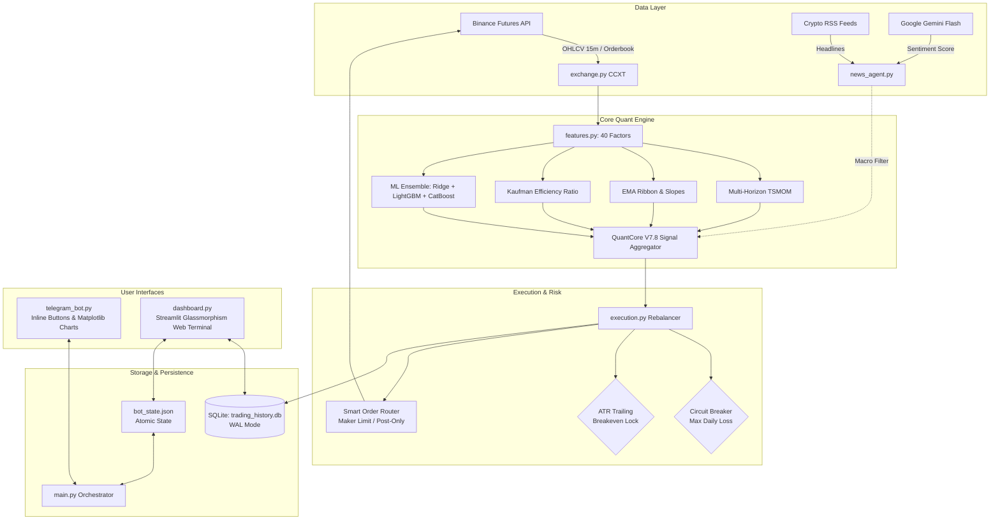

# ⚡ QuantCore V7.8 Ultra — Institutional Trading Agent

[](https://www.python.org/)
[](https://www.binance.com/)
[](https://github.com/ccxt/ccxt)
[](https://streamlit.io/)
[](https://aistudio.google.com/)
[](#-архітектура-системи)

**QuantCore V7.8 Ultra** — автономний алготрейдинговий торговий агент інституційного рівня для безстрокових ф'ючерсів **BTC/USDT** (Binance Futures). 

Система поєднує 40 кількісних факторів (Time-Series Momentum, Kaufman Efficiency Ratio, Donchian Channels, Orderflow Taker Imbalance), ансамбль машинного навчання (Ridge + LightGBM + CatBoost), ШІ-аналіз фундаментального новинного фону через **Google Gemini Flash**, суворий багаторівневий ризик-менеджмент (Circuit Breaker, Dynamic ATR Breakeven), інтерактивний **Telegram-бот** та сучасний **Streamlit Web-термінал** із дизайном Glassmorphism Bento-UI.

---

## 📑 Зміст
1. [Ключові можливості](#-ключові-можливості)
2. [Архітектура системи](#-архітектура-системи)
3. [Структура факторів та сигналів](#-структура-факторів-та-сигналів)
4. [Модуль ризик-менеджменту](#-модуль-ризик-менеджменту)
5. [Інтерфейси керування](#-інтерфейси-керування)
   - [Telegram Bot](#-telegram-бот)
   - [Streamlit Web Terminal](#-веб-термінал-streamlit)
6. [Структура репозиторію](#-структура-репозиторію)
7. [Швидкий старт](#-швидкий-старт)
   - [Вимоги](#вимоги)
   - [Встановлення](#встановлення)
   - [Конфігурація середовища (.env)](#налаштування-env)
   - [Запуск бота](#запуск-торгового-бота)
   - [Запуск веб-панелі](#запуск-веб-дашборду)
8. [Розгортання на Linux/VPS (24/7 Production)](#-розгортання-на-linuxvps-247)
9. [Профілі ризику](#-профілі-ризику)
10. [Безпека та Відмова від відповідальності](#-безпека-та-дисклеймер)

---

## 🚀 Ключові можливості

* **Гібридне кількісне ядро V7.8 Ultra**:
  * **Time-Series Momentum (TSMOM)** на горизонтах від 48 до 1536 барів (15m свічки), нормалізований волатильністю.
  * **Каскад EMA Ribbon** (48, 96, 192, 384, 768, 1536) із відстеженням нахилу (slope) та спреду мувінгів.
  * **Kaufman Efficiency Ratio (KER)**: фільтрація ринкового шуму та оцінка направленості тренду.
  * **Smart Pullback Dip-Buyer**: вхід у позицію під час локальних відкатів у глобальному бичачому тренді (Z-Score + Donchian).
  * **Crash-Shield**: миттєва нейтралізація лонгів та вихід у кеш при каскадних продажах і сплесках волатильності.
* **Ансамбль машинного навчання (ML Ensemble)**:
  * Зважений ансамбль із 3 моделей: `0.40 * Ridge` + `0.30 * LightGBM` + `0.30 * CatBoost`.
  * Робота в однопотоковому режимі (`thread_count=1`, `n_jobs=1`) для нульового оверхеду на CPU.
* **AI-аналіз новин (Google Gemini Flash)**:
  * Автоматичний парсинг криптоновин (Google News RSS, Cointelegraph, CoinDesk).
  * Оцінка ринкового сентименту за допомогою Google Gemini (від -1.0 до +1.0) з автоматичним кешуванням на 60 хв.
  * Демпфування або блокування лонг-сигналів при виявленні негативних новинних аномалій.
* **Режим Zero-Idle CPU Hibernation**:
  * Між 15-хвилинними свічками процес перебуває у глибокому сні з **0.00% навантаженням на CPU**.
  * Автоматичне скидання невикористаної пам'яті через примусовий `gc.collect()`.
  * Миттєве пробудження (`threading.Event`) при отриманні команд користувача з Telegram.
* **Інституційний ризик-менеджмент**:
  * **Circuit Breaker**: автоматичне закриття позицій і зупинка торгівлі при досягненні ліміту денної просадки (за замовчуванням 6%).
  * **Dynamic Breakeven**: автоматичне підтягування біржового Stop-Loss у беззбиток при досягненні прибутку `+1.8x ATR`.
  * **Slippage & Funding Protection**: блокування входів при аномальному спреді стакану (>0.08%) або завищеній ставці фандінгу.
  * Виконання ордерів за алгоритмом **Maker-First Limit** із контролем таймауту для економії комісій.

---

## 🏛 Архітектура системи



---

## 📊 Структура факторів та сигналів

Модуль `features.py` формує 40 інституційних ознак без фрагментації пам'яті (Zero-Fragmentation Vectorized Calculation):

| Категорія | Кількість | Опис векторів |
|:---|:---:|:---|
| **Волатильність** | 3 | `vol_96`, `vol_384`, `vol_ratio_96_384`, `atr_14`, `atr_96` |
| **Momentum (TSMOM)** | 6 | `tsmom_48`, `tsmom_96`, `tsmom_192`, `tsmom_384`, `tsmom_768`, `tsmom_1536` |
| **EMA Ribbon & Dist** | 9 | `dist_ema48` .. `dist_ema1536`, `spread_96_384`, `spread_192_768`, `spread_384_1536` |
| **Нахили тренду (Slope)** | 3 | `slope_384`, `slope_768`, `slope_1536` |
| **Kaufman Ratio (KER)** | 8 | `ker_raw_96` .. `ker_raw_576`, `signed_ker_96` .. `signed_ker_576` |
| **Канали Дончіана** | 4 | `donchian_96`, `donchian_384`, `donchian_768`, `donchian_1536` |
| **Осцилятори & Z-Score**| 4 | `rsi_14`, `rsi_64`, `rsi_192`, `zscore_96` |
| **Orderflow / Taker Imbalance** | 4 | `vol_surge`, `taker_imb_32`, `taker_imb_96`, `taker_imb_192` |

---

## 🛡 Модуль ризик-менеджменту

1. **Daily Circuit Breaker**: відстежує максимальну денну просадку капіталу (Total Equity). При падінні більше ніж на `6%` за добу бот миттєво закриває відкриті позиції, ставить статус пасивного захисту та надсилає сповіщення в Telegram.
2. **Dynamic Breakeven & Stop-Loss**: 
   * Початковий Stop-Loss встановлюється за формулою: `Entry ± (3.5 * ATR)`.
   * При досягненні прибутку `+1.8 * ATR` Stop-Loss переноситься на рівень входу з додаванням буфера біржової комісії (`0.07%`).
3. **Funding Rate Protection**: якщо ставка фандінгу перевищує `0.04%` за 15 хвилин до клірингу, нарощування лонгів призупиняється.
4. **Анти-прослизання (Slippage Guard)**: вхід блокується, якщо поточний спред стакану перевищує `0.08%`.

---

## 📱 Інтерфейси керування

### 🤖 Telegram-бот
* **Миттєві сповіщення**: відкриття/закриття угод, тригери беззбитку, активація Circuit Breaker.
* **Інтерактивна клавіатура**:
  * 📊 **Статус**: актуальна ціна BTC, розмір позиції, нереалізований PnL, маржа.
  * 📈 **Графік**: рендеринг та відправка графіків капіталу (Total Equity) та динаміки балансу через `matplotlib`.
  * ⚙️ **Профіль ризику**: перемикання між `CONSERVATIVE`, `OPTIMAL`, `AGGRESSIVE` в один клік.
  * ⏸ **Пауза / Відновлення**: встановлення паузи (на 1 год, 4 год, 24 год або безстроково).
  * 🚨 **PANIC CLOSE**: аварійне закриття всіх позицій за ринком та блокування торгівлі.
  * 📦 **Резервне копіювання**: щоденний автоматичний експорт бази даних `trading_history.db` у повідомленні бота.

### 💻 Веб-термінал (Streamlit)
* **Glassmorphism Bento-UI**: темна інституційна тема з живими пульсуючими індикаторами статусу.
* **Live Telemetry & Factor Gauges**: детальний моніторинг складових сигналу (TSMOM, Pullback, ML, KER, Orderflow, Sentiment).
* **Інтерактивні графіки (Plotly)**: графік свічок BTC із накладеними точками входу/виходу та графік балансу/просадки (Drawdown Underwater).
* **Журнал угод та аудит**: таблиця завершених транзакцій з розрахунком PnL та перегляд останніх системних логів.
* **Захист паролем**: сесійна авторизація за допомогою змінного ключа `DASHBOARD_PASSWORD`.

---

## 📁 Структура репозиторію

```text
trading_agent/
├── config.py                 # Центральна конфігурація, змінні середовища, константи ризику
├── main.py                   # Головний оркестратор, торговий цикл та гібернація
├── exchange.py               # Клієнт Binance Futures через CCXT (One-Way Mode, плече 2x)
├── features.py               # Розрахунок 40 кількісних факторів та агрегатор сигналів V7.8
├── execution.py              # Виконання ребалансування, Maker Limit ордери, Breakeven, Circuit Breaker
├── news_agent.py             # RSS парсер новин та Gemini AI сентимент-аналізатор
├── database.py               # SQLAlchemy моделі (Trades, EquitySnapshot), режим SQLite WAL
├── telegram_bot.py           # Telegram-бот (слухач, клавіатура, генератор графіків)
├── dashboard.py              # Streamlit веб-термінал з інституційним Glassmorphism інтерфейсом
├── quant_core_production.joblib # [Внесено в .gitignore] Файл навченого ансамблю ML (покладіть перед запуском)
├── requirements.txt          # Список залежностей Python
├── .env.example              # Шаблон змінних середовища для безпечного налаштування
├── .gitignore                # Файл виключень Git (секрети, БД, логи, кеш)
└── Prepearing/               # Допоміжні скрипти досліджень та завантаження даних
    ├── download_history.py   # Скрипт вивантаження великих обсягів історії OHLCV з Binance
    ├── env.py                # Gym/RL середовище (експериментальне)
    └── train.py              # Скрипт навчання моделей
```

---

## ⚡ Швидкий старт

### Вимоги
* **Python**: версія `3.10` – `3.14`
* Акаунт **Binance** (API Key & Secret з увімкненими правами на Futures Trading, рекомендовано Testnet для старту)
* Telegram-бот (токен від [@BotFather](https://t.me/BotFather) та ваш ID від [@userinfobot](https://t.me/userinfobot))
* Ключ **Google Gemini API** (безкоштовно на [Google AI Studio](https://aistudio.google.com/))

### Встановлення

1. **Клонуйте репозиторій**:
```bash
git clone https://github.com/your-username/trading_agent.git
cd trading_agent
```

2. **Створіть та активуйте віртуальне середовище**:
* **Linux / macOS**:
  ```bash
  python3 -m venv .venv
  source .venv/bin/activate
  ```
* **Windows (PowerShell)**:
  ```powershell
  python -m venv .venv
  .\.venv\Scripts\Activate.ps1
  ```

3. **Встановіть залежності**:
```bash
pip install --upgrade pip
pip install -r requirements.txt
```

---

### Налаштування `.env`

Скопіюйте файл-шаблон `.env.example` у `.env`:
```bash
cp .env.example .env
```

Відкрийте `.env` у текстовому редакторі та вкажіть ваші значення:
```dotenv
# Binance Futures API
TESTNET_API_KEY="ваш_binance_api_key"
TESTNET_SECRET_KEY="ваш_binance_secret_key"

# Telegram Bot
TELEGRAM_TOKEN="123456789:ABCdefGhIJKlmNoPQRsTUVwxyZ"
TELEGRAM_CHAT_ID="123456789"

# Google Gemini AI
GEMINI_API_KEY="AIzaSyYourGeminiApiKeyHere"

# Web Terminal Dashboard
DASHBOARD_URL="http://localhost:8501"
DASHBOARD_PASSWORD="ваш_надійний_пароль_до_дашборду"

# Профіль ризику (CONSERVATIVE | OPTIMAL | AGGRESSIVE)
RISK_PROFILE="OPTIMAL"
```

> [!WARNING]
> **НІКОЛИ не комітьте та не публікуйте файл `.env`!** Він автоматично внесений у `.gitignore`.

---

### Файл моделі QuantCore (`.joblib`)

> [!NOTE]
> Файл ваг моделі `quant_core_production.joblib` внесений у `.gitignore` (для збереження вашої інтелектуальної власності та щоб уникнути важких бінарних файлів у Git). 
> Переконайтеся, що файл вашої натренованої моделі `quant_core_production.joblib` знаходиться у кореневій директорії проекту на вашому комп'ютері чи сервері перед запуском `main.py`.

---

### Запуск торгового бота

Запустіть головний процес торгового агента:
```bash
python main.py
```
При запуску бот:
1. Перевірить підключення до Binance Futures.
2. Ініціалізує базу даних `trading_history.db` у режимі WAL.
3. Завантажить ваги навченого ансамблю `quant_core_production.joblib`.
4. Запустить потік слухача Telegram-бота.
5. Надішле привітальне сповіщення про старт у Telegram і перейде в режим аналізу 15m свічок.

---

### Запуск веб-дашборду

В окремому терміналі запустіть веб-панель Streamlit:
```bash
streamlit run dashboard.py --server.port 8501 --server.address 0.0.0.0
```
Після цього відкрийте браузер за адресою `http://localhost:8501` (або `http://IP_ВАШОГО_СЕРВЕРА:8501`) та введіть пароль, зазначений у `DASHBOARD_PASSWORD`.

---

## 🖥 Розгортання на Linux/VPS (24/7)

Для безперервної роботи 24/7 на сервері (Ubuntu/Debian) налаштуйте службу **systemd**:

### 1. Сервіс торгового бота: `/etc/systemd/system/trading-bot.service`
```ini
[Unit]
Description=QuantCore V7.8 Trading Agent
After=network.target

[Service]
Type=simple
User=root
WorkingDirectory=/root/trading_agent
ExecStart=/root/trading_agent/.venv/bin/python main.py
Restart=always
RestartSec=10
Environment="PYTHONUNBUFFERED=1"

[Install]
WantedBy=multi-user.target
```

### 2. Сервіс веб-панелі: `/etc/systemd/system/trading-dashboard.service`
```ini
[Unit]
Description=QuantCore V7.8 Streamlit Dashboard
After=network.target

[Service]
Type=simple
User=root
WorkingDirectory=/root/trading_agent
ExecStart=/root/trading_agent/.venv/bin/streamlit run dashboard.py --server.port 8501 --server.address 0.0.0.0
Restart=always
RestartSec=10

[Install]
WantedBy=multi-user.target
```

### 3. Активація та запуск служб:
```bash
sudo systemctl daemon-reload
sudo systemctl enable trading-bot trading-dashboard
sudo systemctl start trading-bot trading-dashboard

# Перевірка статусу
sudo systemctl status trading-bot
```

---

## 📈 Профілі ризику

Ви можете динамічно перемикати профілі ризику через `.env`, веб-панель або через кнопки в Telegram:

| Профіль | Базовий розмір (Tier-1) | Максимальний розмір (Max Conviction) | Історичний Net Return | Історичний MaxDD | Призначення |
|:---|:---:|:---:|:---:|:---:|:---|
| **CONSERVATIVE** | **0.75x** | **1.00x** | +25.91% | -12.51% | Збереження капіталу з мінімальним плечем |
| **OPTIMAL** | **0.80x** | **1.30x** | +32.99% | -15.96% | **Рекомендований баланс** дохідності та просадки |
| **AGGRESSIVE** | **1.00x** | **1.50x** | +38.14% | -18.42% | Максимізація прибутку під час трендових фаз |

---

## 🔒 Безпека та Дисклеймер

### Рекомендації з безпеки
1. **Обмеження прав API**: на Binance створіть окремий API Key **виключно** для торгівлі деривативами (Futures). **Вимкніть** дозвіл на виведення коштів (Withdrawals).
2. **IP Whitelisting**: налаштуйте прив'язку API ключа Binance тільки до статичної IP-адреси вашого сервера.
3. **Захист портів**: закрийте порт `8501` фаєрволом (`ufw`) або використовуйте зворотний проксі (Nginx) з HTTPS (SSL/TLS через Certbot).

### Відмова від відповідальності (Disclaimer)
> [!CAUTION]
> **Торгівля криптовалютними деривативами та ф'ючерсами несе високий рівень фінансового ризику та може призвести до повної втрати капіталу.**
> Цей програмний код надається виключно в освітніх та дослідницьких цілях («як є», без будь-яких явних чи неявних гарантій). Автор не несе відповідальності за будь-які фінансові збитки, спричинені використанням цієї системи або збоями біржових API. Завжди тестуйте стратегію на тестовій мережі (Binance Testnet) перед роботою з реальними коштами.

